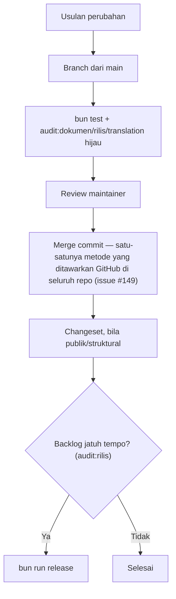

🇮🇩 Bahasa Indonesia · 🇬🇧 [English (source)](GOVERNANCE.md)

<!-- i18n-source-hash: sha256:aee58c68b6886dcf9d579a8f0766649772ed42d31abc82d28598ff4e68b55a8f -->

# Governance

## Prinsip yang mengikat setiap keputusan

**Repo ini adalah wajah publik, sistem konten, dan deployment sebuah produk (OMES), yang dibangun di atas template yang sendirinya merupakan re-platform toko komersial sungguhan.** Cacat di sini bukan sesuatu yang abstrak: CMS menyimpan data milik produk di bawah row-level security, situs publik adalah yang dibaca dan dijadikan sumber instalasi oleh pengunjung, dan modul commerce warisan template dirancang untuk menanggung transaksi sungguhan. Setiap keputusan dinilai terhadap itu.

Konsekuensinya:

- Aturan baru membawa pemeriksanya sendiri bila memungkinkan. Aturan yang hanya ditulis adalah aturan yang akan luntur, dan yang paling berbahaya adalah yang tampak terjaga padahal tidak.
- Re-platform berarti mengekspresikan ulang, bukan menebak. Keputusan skema yang tidak bisa dilacak balik ke basis data `commerce_bj_mart` yang hidup adalah keputusan yang dibuat atas asumsi, di ranah yang asumsinya sebenarnya bisa diperiksa.
- Sebuah gerbang dilonggarkan hanya lewat keputusan yang disengaja dan tercatat — tidak pernah diam-diam, demi membuat CI hijau.

## Peran

| Peran | Wewenang |
| --- | --- |
| **Maintainer** | Menyetujui merge, memutuskan pertanyaan cakupan, menerbitkan rilis dan tag |
| **Kontributor** | Mengusulkan perubahan pada kode atau dokumentasi repo ini, beserta alasannya dan (bila memungkinkan) pemeriksanya |
| **Penerjemah** | Mengisi dan menyunting cermin Indonesia dokumen governance |
| **Agen AI** | Boleh melakukan apa pun yang diizinkan [`AGENTS.md`](AGENTS.md) |

Peran di dalam `apps/cms` untuk kemampuan generiknya sendiri — admission modul, kebijakan RBAC/ABAC — mengikuti governance `awcms` sendiri sebagaimana dibawa di `apps/cms/GOVERNANCE.md`; dokumen ini mengatur `omes-web` sebagai repositori, bukan otoritas desain internal `awcms` sendiri.

## Mencatat sebuah keputusan

Repo ini punya log architecture-decision-record formal di [`docs/adr/`](docs/adr/), dengan indeks di [`docs/adr/README.md`](docs/adr/README.md). Keputusan yang mengubah struktur repo ini, model datanya, atau sebuah aturan di `AGENTS.md` dicatat sebagai ADR di sana, bersama pull request yang membuatnya dan, bila perubahannya publik atau struktural, changeset-nya (lihat [`.changesets/README.md`](.changesets/README.md)).

`bun run audit:dokumen` menegakkan indeks itu: indeks dua arah yang lengkap, tanpa baris ganda, kesesuaian status, dan kutipan `ADR-NNNN` yang resolve.

Sebuah changeset saja cukup untuk perbaikan bug, perubahan gaya, komponen baru yang mengikuti kontrak yang sudah ada, atau pembaruan dependency rutin.

## Alur keputusan

## Perubahan yang tidak boleh dilakukan sendirian

Yang berikut selalu butuh keputusan maintainer yang tercatat, sekecil apa pun perubahannya tampak:

- Meng-merge PR `git subtree pull` dengan cara selain merge commit — sejak issue #149 ini juga mustahil secara mekanis di seluruh repositori, bukan lagi sekadar aturan yang harus dipatuhi.
- Melonggarkan sebuah gerbang demi membuat CI hijau. Bila aturannya memang salah, ubah dengan sengaja, sertakan alasannya, dan catat kenapa di PR.
- Menyunting sumber `apps/cms` dengan cara yang besar kemungkinan akan bentrok dengan atau diam-diam ditimpa oleh `git subtree pull` berikutnya, alih-alih mengontribusikan perubahannya ke upstream lebih dulu.

## Rilis

Wewenang maintainer, dijalankan lewat `bun run release` (lihat [`tools/rilis.mjs`](tools/rilis.mjs)) begitu `bun run audit:rilis` menunjukkan backlog `.changesets/` yang menunggu sudah jatuh tempo. Apa arti `bump` tiap changeset dan format tag-nya: [`.changesets/README.md`](.changesets/README.md).
